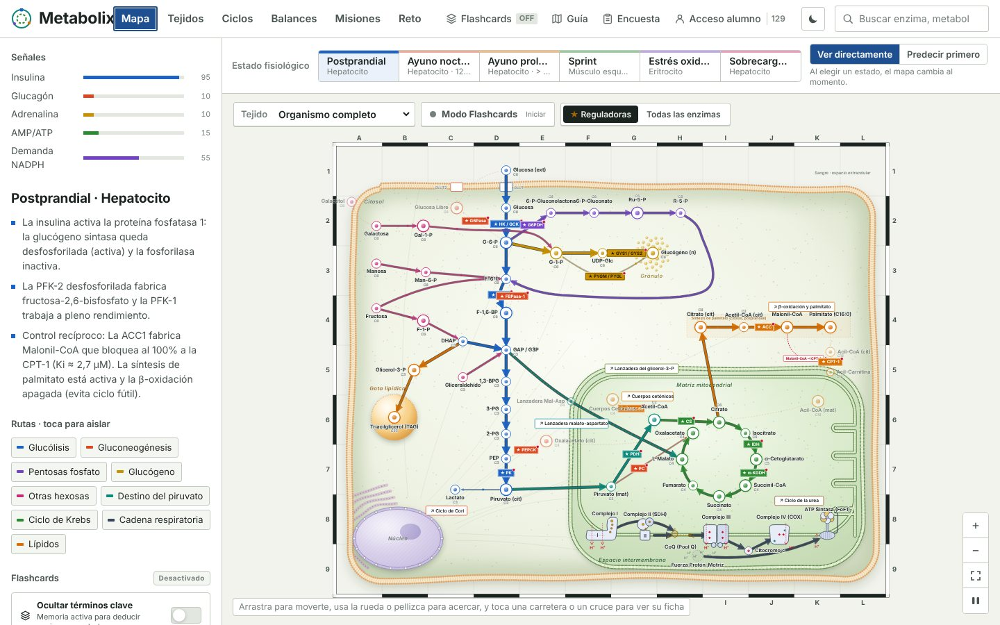
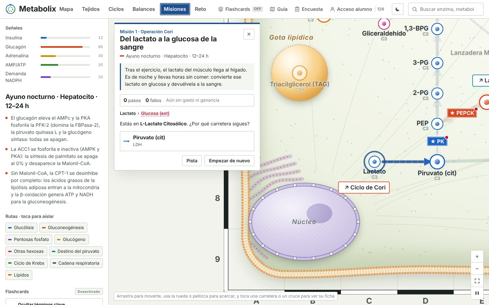

# Metabolix

Mapa interactivo del metabolismo humano para enseñar Bioquímica en los grados de Ciencias de la Salud. El metabolismo se lee como un mapa de carreteras: cada ruta es una carretera, las enzimas son las señales y el tráfico cambia según el estado fisiológico.

Proyecto de Innovación Docente del Departamento de Bioquímica y Biología Molecular III e Inmunología, Facultad de Medicina, Universidad de Granada.

**App:** [metabolxmap.vercel.app](https://metabolxmap.vercel.app)



## Qué puede hacer el alumno

**Mapa.** La célula está dibujada con sus compartimentos (citosol, mitocondria, núcleo, gota lipídica) y las rutas como carreteras. El grosor de cada carretera indica el flujo; las rutas apagadas aparecen como caminos punteados y las partículas muestran el sentido neto. Al tocar una enzima o un metabolito se abre su ficha: ecuación, ΔG°′, reguladores, isoenzimas y relevancia clínica. Las enzimas reguladoras llevan ★, y una cuadrícula de atlas (A–L, 1–9) permite decir «la PEPCK está en la casilla H4».

**Estados fisiológicos.** Encima del mapa: postprandial, ayuno nocturno, ayuno prolongado, sprint, estrés oxidativo y sobrecarga de fructosa. Cada estado cambia las señales hormonales (insulina, glucagón, adrenalina, AMP/ATP, demanda de NADPH) y con ellas el flujo de todas las rutas. El selector de tejido muestra qué rutas tiene el hígado, el músculo, el corazón, el cerebro, el tejido adiposo, el eritrocito o el riñón.

**Predecir primero.** Con el interruptor «Predecir primero», al cambiar de estado el alumno marca antes cada proceso como activo, poco activo o apagado, y después lo comprueba con la explicación de cada caso. Con «Ver directamente», el mapa cambia al momento. La elección se recuerda.

**Misiones.** El alumno lleva una molécula de un punto del mapa a otro eligiendo la carretera en cada cruce. Las carreteras se abren o se cortan según el estado fisiológico, los pasos irreversibles son de sentido único y los transportadores son fronteras. Un cuentakilómetros suma ATP, NADH y CO₂ por el camino.

| Misión | Estado | Recorrido |
|---|---|---|
| Operación Cori | Ayuno nocturno | Lactato → glucosa en sangre |
| Fábrica de grasa | Postprandial | Glucosa → palmitato |
| La ruta de la leche | Postprandial | Galactosa → glucógeno |
| Combustible de emergencia | Ayuno prolongado | Palmitato → cuerpos cetónicos |
| Sprint final | Sprint | Glucógeno → lactato |
| Reciclar la grasa | Ayuno nocturno | Glicerol-3-P → glucosa |



**Otras vistas.**
- *Tejidos*: rutas universales frente a especialización tisular.
- *Ciclos*: ciclo de Cori, ciclo de la urea, cuerpos cetónicos, lanzaderas malato-aspartato y glicerol-3-P, β-oxidación frente a síntesis de palmitato.
- *Balances*: ATP de cada sustrato, paso a paso.
- *Reto*: preguntas de razonamiento. A partir del tercer reto se pide la encuesta.
- *Flashcards*: oculta los nombres del mapa para repasar, con autoevaluación y estadísticas por ruta.
- *Galactosemia*: el bloqueo de la GALT y la vía del galactitol en el cristalino.

**Para el profesorado.** La encuesta de satisfacción (Likert 1–5, con titulación y curso) se exporta en CSV o JSON. Hay un registro opcional del alumno y un contador de visitas.

## Desarrollo

Necesitas Node.js 18 o superior.

```bash
git clone https://github.com/ctp-granada/MetabolxMap.git
cd MetabolxMap
npm install
npm run dev        # http://localhost:3000
```

| Script | Qué hace |
|---|---|
| `npm run dev` | Servidor de desarrollo en el puerto 3000 |
| `npm run build` | Compilación de producción en `dist/` |
| `npm run preview` | Sirve la compilación para revisarla |
| `npm run lint` | Comprobación de tipos con TypeScript |

**Publicación.** Vercel publica automáticamente cada cambio que entra en `main`. Para trabajar, crea una rama, abre un pull request y fusiónalo cuando esté revisado.

> El proyecto nació en Google AI Studio, pero ahora la versión de referencia es este repositorio. No vuelvas a guardar desde AI Studio sobre él, porque sobrescribiría los cambios.

### Dónde está cada cosa

```text
src/
├── metabolixData.js        Metabolitos, reacciones y balances de sustratos
├── metabolixEngine.js      Motor: flujos, dibujo del mapa, estados, fichas,
│                           Predecir primero, Misiones y Reto
├── metabolixTemplate.ts    Estructura HTML de la app (pestañas, paneles, mapa)
├── metabolixTissues.js     Perfiles de cada tejido
├── metabolixGalactose.js   Vista de galactosemia
├── metabolixLipids.js      Vista de lípidos
├── index.css               Diseño: colores, tipografía y estilos del mapa
├── App.tsx, main.tsx       Arranque de React y modales
├── components/             Guía, encuesta y acceso del alumno
└── services/
    └── storageService.ts   Guardado local y sincronización opcional con Firestore
```

`src/metabolixTemplate.html` es una copia antigua de la plantilla y no se usa.

### Cambios habituales

- **Estados fisiológicos**: `STATES` en `metabolixEngine.js`. Cada estado tiene sus señales (`sig`), la actividad de cada ruta (`pw`) y de cada reacción (`rx`), y las notas que aparecen en el panel.
- **Procesos de Predecir primero**: `PRED_ITEMS`. Los umbrales están en `levelIn`: activa ≥ 0,55, poco activa ≥ 0,12, y apagada por debajo.
- **Misiones**: `MISSIONS`. Cada misión tiene estado, origen, destino, introducción, pistas por reacción e ideas clave. Escribe `__msCheck()` en la consola del navegador para comprobar que todas tienen camino.
- **Colores y tipografía**: variables al principio de `index.css`. Los colores de las rutas (`--pw-*`) llevan información, así que conviene no cambiarlos a la ligera.

### Datos y privacidad

Todo se guarda primero en el navegador (`localStorage`): retos, encuestas, visitas, resultados de las misiones y preferencias. Si hay una configuración de Firebase, las respuestas se copian también en Firestore para analizarlas.

## Diseño

- **Carreteras con arcén**: cada ruta es una carretera con borde, en el color de su ruta.
- **Placas de carretera**: las enzimas se presentan como placas.
- **Paleta**: papel blanco frío y el azul de las señales de autovía.
- **Tipografía**: Barlow, inspirada en la señalización vial.
- **Modo oscuro**: incluido.
- **Célula con volumen**: la célula y la cadena respiratoria se dibujan con relieve para que se reconozcan las estructuras reales sin tapar las rutas.

## Cómo citar

Si usas, adaptas o difundes Metabolix, cita su origen:

> Metabolix: mapa interactivo del metabolismo humano. Departamento de Bioquímica y Biología Molecular III e Inmunología, Facultad de Medicina, Universidad de Granada. Proyecto de Innovación Docente. https://github.com/ctp-granada/MetabolxMap

GitHub también ofrece la cita con el botón «Cite this repository», a partir de `CITATION.cff`.

## Licencia

- **Código:** [Apache 2.0](LICENSE). Quien lo redistribuya o lo adapte debe conservar el aviso de autoría del archivo [NOTICE](NOTICE).
- **Contenidos docentes** (textos, fichas, explicaciones, preguntas, misiones y diseño del mapa): [CC BY 4.0](https://creativecommons.org/licenses/by/4.0/deed.es). Se pueden reutilizar y adaptar siempre que se cite la autoría.

---

**Departamento de Bioquímica y Biología Molecular III e Inmunología**<br>
Facultad de Medicina · Universidad de Granada<br>
Proyecto de Innovación Docente
